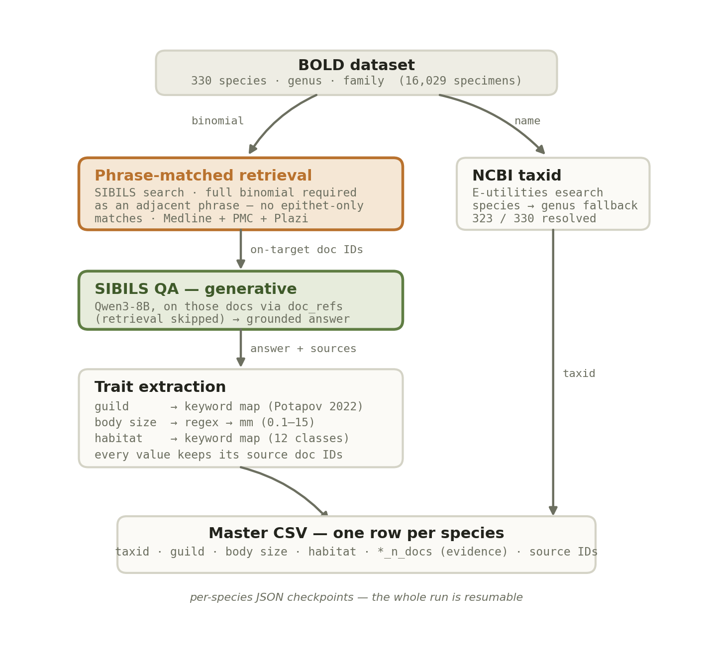

# Collembola functional traits from literature (SIBiLS QA)

Species-level functional-trait annotations for **330 Collembola species** (from a BOLD COI
barcode dataset), mined from the published literature with the [SIBiLS](https://sibils.org)
question-answering service. Three traits are covered, **trophic guild, body size and
habitat**, and every value is traceable to the source documents it came from. NCBI
Taxonomy IDs are included so the taxonomic path of each taxon can be verified.

**Version 4** (October 2026) follows the same curators' review of v3. Their verdict was
that the assignments were "greatly improved, especially thanks to the separation between
direct and indirect information", with one remaining issue: the habitat vocabulary. v4
replaces the single habitat label with two axes, an EUNIS macrohabitat and a microhabitat,
and fixes the smaller issues they found.

**Version 3** (September 2026) followed a detailed review by Matteo Montagna and Paola
Costagliola (University of Naples Federico II), who checked the v2 values against the cited
sources. Their central finding was that a value can come from the right document and still
be wrong: a measurement belonging to a congeneric species, a diet inferred from the
substrate an animal was collected from, a habitat inferred from a collection locality. v3
addresses this by extracting claims rather than keywords, and by separating what the
literature states from what it merely suggests.

## What changed in v4

**Habitat is two axes, not one.** v3's `forest_wood` merged a habitat (forest) with a
substrate (wood), so a species recorded in a forest was labelled wood-associated. The
reviewers asked for a standard vocabulary and suggested EUNIS. But EUNIS classifies
*macrohabitats* (forest, grassland, cave, wetland), while springtails are usually described
by *microhabitat* (leaf litter, dead wood, moss) found inside those. A species in leaf litter
in a beech forest is EUNIS **G** at one level and `leaf_litter` at the other. With two
columns the two cannot collapse into one label.

Smaller fixes, each from a specific reviewed case:

- A habitat named only to say a species is rare or absent there is no longer assigned
  ("very rare in steppes" had produced grassland).
- Riparian and river-bank habitats no longer imply inland water; they are terrestrial.
- Dispersion values are no longer parsed as measurements ("1.5 mm with a standard deviation
  of 0.1 mm" had produced a 0.1–1.5 mm range).
- "No specific measurement is given" is now recognised as a denial.
- Body-size notes name the congener a demoted value belongs to, rather than saying only that
  the target's value is not stated.

## What changed in v3

Extraction now works sentence by sentence and asks three questions of every candidate
value:

1. **Is the target species the subject of this sentence**, or is it another taxon? A
   measurement is attributed to the nearest taxon named before it, so a length belonging to
   a congener is no longer assigned to the target.
2. **Does the sentence assert the value, or hedge or deny it?** Answers often state a value
   and then retract it. *Stenaphorura quadrispina* is a clear case: the source gives 1330
   um, then says the measurement belongs to *S. lubbocki* and that the target's length is
   not stated. A denial anywhere in an answer now blocks promotion of any value from it.
3. **What kind of evidence is it?** Direct observation, a laboratory feeding trial,
   co-occurrence in a substrate, or a predation relationship running the other way.

Occurrence is no longer treated as diet, geography is no longer treated as habitat, and
laboratory evidence is retained but marked.

**Nothing is discarded.** Values that fail these tests move to an `*_indirect` column with
the reason recorded, so the evidence remains available without being presented as an
established trait.

## Data

[`collembola_species_traits_v4.csv`](collembola_species_traits_v4.csv), one row per
species (330 rows). The v2 and v3 files are kept for comparison; each is reproducible from
the extraction module of the same version.

### Identification

| Column | Description |
|---|---|
| `species`, `genus`, `family` | Taxonomy as recorded in BOLD |
| `ncbi_taxid` | NCBI Taxonomy ID |
| `taxid_matched_rank` | Lowest rank at which the taxon is found in NCBI: `species`, `genus`, or `family` |
| `taxid_status` | `species`, `genus_fallback` or `family_fallback`. Every match is verified: NCBI must return the same name, within Collembola. `N/A` if nothing verifies |
| `ncbi_family`, `family_conflict_bold_ncbi` | Family in NCBI, and `yes` where it differs from the family in BOLD |

### Traits

Each of the three traits carries the same six columns.

| Column | Description |
|---|---|
| `trophic_guild` / `body_size_mm` / `habitat_eunis` and `microhabitat` | **The value.** Explicit, species-specific evidence only. |
| `*_indirect` | Values that did not meet that standard, kept with their reason |
| `*_evidence_type` | `direct` (observation or field study) or `experimental` (laboratory feeding trial) |
| `*_note` | Why a value was demoted, or what qualifies it, e.g. "body size of the target species not available; the value reported in the source is for *Friesea major*" |
| `*_n_docs` | Species-specific documents behind the answer (0 = no species-specific evidence) |
| `*_sources`, `*_qa_answer` | Source document IDs (PMID / PMCID / Plazi) and the grounded QA answer |

Trophic guilds follow Potapov et al. (2016, 2022). `trophic_guild_potapov` gives the level-1
guild used in the project vocabulary: Herbivores, Detritivores, Microbivores, Carnivores.
`trophic_guild` keeps the subcategory: herbivore and algivore (Herbivores), fungivore,
bacterivore and microbivore (Microbivores), detritivore, predator (Carnivores). One indirect
"omnivore" has no Potapov equivalent and appears only in the subcategory column.

**`habitat_eunis`** uses EUNIS level 1, 2012 letter codes: A Marine · B Coastal · C Inland
surface waters · D Mires, bogs and fens · E Grasslands · F Heathland, scrub and tundra ·
G Woodland and forest · H Inland unvegetated (caves, ice, scree) · I Cultivated and
agricultural · J Constructed and artificial.

**`microhabitat`**: soil, leaf_litter, moss_lichen, deadwood, bark, water_surface,
under_stones, dung_compost.

### Specimen metadata

Geography, collection date and life stage are recorded per specimen in the BOLD source and
are aggregated here per species. They are **not** literature-mined, and are reported
separately for that reason. `bold_habitat` is BOLD's own field-recorded habitat, which
gives an independent reference against which the literature-mined `habitat` column can be
compared.

| Column | Description |
|---|---|
| `bold_n_specimens` | Barcode records for the species |
| `bold_life_stage`, `bold_habitat`, `bold_sampling_protocol` | As recorded by the collectors |
| `bold_country`, `bold_province`, `bold_coord`, `bold_elev_m` | Collection geography |
| `bold_collection_dates` | Year range of collection |
| `bold_biome`, `bold_ecoregion` | Biogeographic context |

## Results at a glance

| | v2 | v3 | **v4** | v4 indirect |
|---|---:|---:|---:|---:|
| Trophic guild | 40 | 15 | **15** | 23 |
| Body size | 27 | 15 | **14** | 12 |
| Habitat, EUNIS macrohabitat | | | **106** | 76 |
| Habitat, microhabitat | | | **106** | 43 |
| Habitat, either axis | 221 | 149 | **143** | |
| NCBI taxid, species level (verified) | | | **233** | |
| NCBI taxid, genus fallback (verified) | | | **89** | |
| NCBI taxid, family fallback (verified) | | | **8** | |

The primary counts are lower because the reviewers rejected 68% of v2 trophic guilds and
56% of v2 body sizes. Fewer values, each one defensible, with the rejected evidence still
visible in the indirect columns.

Specimen metadata, newly included: life stage for 281 species, field habitat and
coordinates for all 330, collection year range for 320.

## Evaluation

Both reviews are encoded as test sets, and every version is scored against both.

| | Round 1 (v2 review, 56 cases) | Round 2 (v3 review, 14 cases) |
|---|---:|---:|
| Rejected value no longer assigned | **49 / 56 (88%)** | **12 / 14 (86%)** |
| Reviewer's expected value reached | 41 / 56 (73%) | 9 / 14 (64%) |

For habitat, the reviewers checked all 128 species with habitat information in the second
round. v4 introduces no regression on the first round.

[`review_adjudication_2026-09.csv`](review_adjudication_2026-09.csv) ·
[`review_adjudication_2026-10_v3.csv`](review_adjudication_2026-10_v3.csv)

The gap between the two is informative. Removing a wrong value is something extraction can
do on its own. Recovering the *right* value often cannot be done from a cached answer,
because the answer summarises the document rather than reproducing it, whereas the
reviewers were reading the full sources. Those cases need the question re-asked against the source text, which
is the next step rather than a limitation of the approach.

## Reproducing

```bash
scripts/collembola_species_traits.py    # full run: retrieval + QA + extraction (needs SIBiLS API)
scripts/rebuild_traits_v3.py            # re-extract from cached answers, no API calls
scripts/score_against_review.py         # score the output against the partner review
```

`rebuild_traits_v3.py` reads the per-species QA answers cached under
`results/checkpoints_species_v2/` and applies `scripts/trait_extraction_v3.py`, so the
extraction rules can be changed and re-scored without re-querying anything. Checkpoints and
the BOLD source file are not in the repository; the BOLD dataset belongs to BOLD, and the
checkpoints regenerate from a full run.

## Method



For each species and trait, retrieval **requires the full binomial as an adjacent phrase**
(genus + specific epithet linked) across Medline, PMC and Plazi, so the specific epithet
alone can never match a different organism sharing it (*polaris* → the stonefly
*Arcynopteryx polaris*; *gibbosa* → the snail *Chilina gibbosa*). Trait-relevant terms are
added as a ranking boost. A generative SIBiLS QA answer (Qwen3-8B) is produced from exactly
those documents, and claim-level extraction derives the structured values described above.
NCBI taxids come from E-utilities, searched on the exact scientific name. A hit is accepted
only if NCBI returns that same name within Collembola; otherwise the genus, then the family
recorded in BOLD, is tried under the same check; if nothing verifies the taxid is `N/A`. Until October 2026 the first hit
of a bare search was accepted, and for species absent from NCBI, NCBI matches single words
instead: ten species received the taxid of an unrelated organism sharing the epithet
(*Halisotoma arenicola* → the lugworm *Arenicola*, *Tetracanthella brachyura* → the crabs,
Brachyura). Bachir Balech identified these. The taxid was never used for retrieval, which is
keyed on the binomial, so no trait value was affected.

If no document mentions the full binomial, the trait is left blank. No information from a
different taxon is ever assigned to a species.

## Known limitations

Read the QA answer and follow the source IDs before relying on any value.

- **Sparse where the literature is silent.** Most species have documents that mention them,
  typically Plazi taxonomic treatments, that never state diet or size. Those rows are empty
  rather than borrowing from a congener. This is deliberate.
- **The QA answer can overstate its source.** In a few cases the answer asserts a habitat or
  a measurement more confidently than the underlying document supports. Claim-level
  extraction cannot detect this, because the overstatement is already in the text it reads.
  These are the cases behind the 88%/75% gap.
- **Body size remains under-recovered.** Plazi taxonomic treatments carry many measurements
  that a dedicated pass over the treatment structure, rather than over a summary answer,
  could mine far more completely.
- **Habitat is multi-label and keyword-derived.** Categories resting only on a general term
  ("coastal", "marine") rather than an ecological descriptor are routed to `habitat_indirect`.
- **NCBI taxid**: `genus_fallback` means the species name is not in NCBI Taxonomy, and
  spelling variants fall back too (*Willowsia buski* vs NCBI *W. buskii*). 25 of the 26
  BOLD/NCBI family conflicts are one systematic disagreement: BOLD follows the newer
  classification that raises Lepidocyrtidae, Orchesellidae and Seiridae to family rank,
  while NCBI keeps them within Entomobryidae.

## Provenance

Every value carries the QA answer it came from, the number of species-specific documents
behind it, and the source document IDs. No manual curation was applied to the values in
this file; the reviewers' corrections informed the extraction rules, not the individual
cells.
